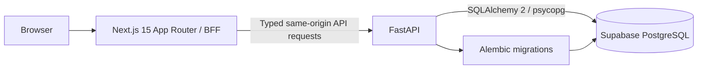

# CareSlot

CareSlot is a clinic appointment booking system for patients, doctors, and clinic administrators. Patients search providers and manage appointments; doctors maintain recurring availability and time off; administrators manage the provider directory and appointment statuses.

## Architecture



Only FastAPI receives `DATABASE_URL`. The browser talks to Next.js route handlers, which proxy requests to FastAPI and keep access/refresh JWTs in HttpOnly cookies. Next.js does not use Supabase SDKs or APIs.

## Requirements

- Python 3.12
- Node.js 22 LTS and npm
- A Supabase project used as a hosted PostgreSQL database
- Docker Compose (optional)

## Local Setup

1. Copy `backend/.env.example` to `backend/.env` and set `DATABASE_URL` to the Supabase PostgreSQL connection string. Use the `postgresql+psycopg://` driver form and the connection string supplied by Supabase; append `?sslmode=require` if the supplied URL does not already require TLS. Replace `JWT_SECRET` with a random secret.
2. Copy `frontend/.env.example` to `frontend/.env`. The default backend URL is correct when running both services locally.
3. Set up and start the API:

   ```powershell
   cd backend
   py -3.12 -m venv .venv
   .venv\Scripts\Activate.ps1
   pip install -r requirements.txt
   alembic upgrade head
   python scripts/seed.py
   uvicorn app.main:app --reload
   ```

4. In another terminal, install and start the frontend:

   ```powershell
   cd frontend
   npm ci
   npm run dev
   ```

Open `http://localhost:3000`. The API health check is at `http://localhost:8000/health` and OpenAPI docs are at `http://localhost:8000/docs`.

## Docker Compose

Create both env files as described above, then run from the repository root:

```powershell
docker compose up --build
```

The API container applies Alembic migrations before starting. To seed the hosted database:

```powershell
docker compose exec backend python scripts/seed.py
```

The Compose stack does not create a local database; configure the backend `.env` with the Supabase database URL.

## Demo Accounts

The seed command creates these accounts; each uses the local/demo password `CareSlotDemo!2026`:

| Role | Email |
| --- | --- |
| Admin | `admin@careslot.test` |
| Doctor | `doctor@careslot.test` |
| Patient | `patient@careslot.test` |

Change or remove demo credentials before exposing a seeded environment publicly.

## Environment Variables

| Variable | Service | Description |
| --- | --- | --- |
| `DATABASE_URL` | Backend | Supabase PostgreSQL connection string; the only database connection in the system |
| `JWT_SECRET` | Backend | Signing key for access and refresh JWTs |
| `ACCESS_TOKEN_MINUTES` | Backend | Access-token lifetime; defaults to 15 |
| `REFRESH_TOKEN_DAYS` | Backend | Refresh-token lifetime; defaults to 14 |
| `FRONTEND_ORIGIN` | Backend | Exact allowed browser origin for CORS |
| `ENVIRONMENT` | Backend | Runtime environment name |
| `BACKEND_API_URL` | Frontend | Server-side FastAPI URL used by the Next.js BFF |

Do not expose database credentials or `JWT_SECRET` to the frontend. `.env` files are ignored by Git; commit only `.env.example` files.

## Tests and Checks

```powershell
cd backend
pytest
```

The backend tests use isolated SQLite and do not require a Supabase account. PostgreSQL-only concurrency protection is installed by the Alembic migration. Frontend checks:

```powershell
cd frontend
npm run lint
npm run typecheck
npm run build
```

GitHub Actions runs backend tests and frontend lint, type-check, and build on pushes to `main` and pull requests.

## Deployment

- **Supabase:** create a PostgreSQL project and use its direct or pooled connection string with the appropriate psycopg URL and TLS setting. Ensure the database role can install/use `btree_gist` for the exclusion constraint.
- **Render:** deploy `backend` as a Python web service using `backend/Dockerfile` or run `uvicorn app.main:app --host 0.0.0.0 --port $PORT`. Configure all backend variables and set `FRONTEND_ORIGIN` to the deployed Vercel origin. Run Alembic migrations as a release command when not using the provided Docker startup command.
- **Vercel:** deploy `frontend` as a Next.js project with root directory `frontend`. Set `BACKEND_API_URL` to the deployed Render API origin. The BFF and its HttpOnly cookies must remain same-origin with the browser app.

## Scope Notes

Appointments are in-person clinic visits. Payments, telehealth, messaging, medical records, and multi-clinic management are not included. Availability rules are weekly and stored as clinic-local wall-clock times; appointment instants and time off are stored in UTC.